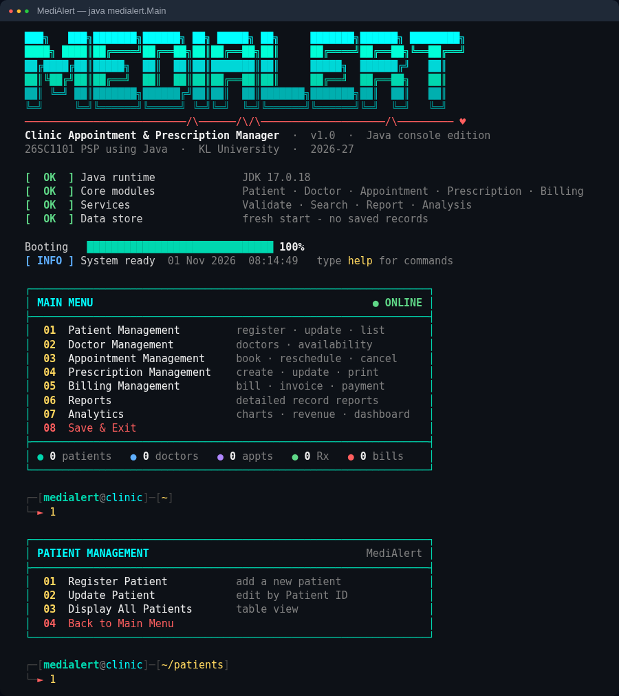

# MediAlert – Clinic Appointment & Prescription Manager

A console-based Java application that manages patients, doctors, appointments,
prescriptions and billing for a small clinic - with a colourful, developer-style
terminal interface.



**Course:** 26SC1101 – Problem Solving & Programming using Java · KL University · 2026-27
**Team:** P. Deepthanush Chowdary (2600031735) · C. Narasimha Bhargav (2600031878) ·
G. Manohar (2600031779) · Y. Sneha Naga Sindhu (2600031833)
**Faculty Mentor:** A. Smitha Kranthi, Asst. Professor

---

## Requirements

- Java JDK 8 or newer (`java -version` to check)
- Any OS: Windows, Linux or macOS

## How to run

**Windows** – double-click `run.bat`, or in Command Prompt:

```
run.bat
```

**Linux / macOS:**

```
chmod +x run.sh
./run.sh
```

**Manually (any OS):**

```
javac -encoding UTF-8 -d out src/medialert/*.java
java -Dfile.encoding=UTF-8 -cp out medialert.Main
```

**Hands-free demo for presenting** - `run-demo.bat` (Windows) or `./run-demo.sh`.
It auto-types the sample data (2 patients, 2 doctors, 3 appointments,
1 prescription, 1 bill), shows every screen, the charts and the dashboard,
then saves and exits.

## Terminal features

- Gradient **MEDIALERT** logo, heartbeat line and an animated boot sequence
- Shell-style prompt that shows where you are: `┌─[medialert@clinic]─[~/patients]`
- Status tags: `[  OK  ]` green, `[ FAIL ]` red, `[ WARN ]` yellow, `[ INFO ]` blue
- Live record counters under the main menu
- Records shown in coloured tables; appointment status colour-coded
  (Booked green, Rescheduled yellow, Cancelled red)
- Boxed prescription slip and invoice cards, bar chart for doctor-wise
  consultations, revenue card and a dashboard of tiles
- Animated progress bars for reports, payments and saving
- Typed input shows in yellow; bad input never crashes the program

**Commands at any menu prompt**

| Type | Does |
|---|---|
| `1` - `8` | pick a menu option |
| `back` or `b` | go back one level (on the main menu: Save & Exit) |
| `clear` | clear the screen |
| `help` | list these commands |

**Options**

| Flag | Effect |
|---|---|
| `--demo` | shows piped input as if it were being typed (used by `run-demo`) |
| `--fast` | turns off all animations |
| `--no-color` | plain text (also turned off by the `NO_COLOR` variable) |

Colours work in Windows Terminal, the VS Code and IntelliJ terminals, macOS
Terminal and Linux terminals. On the old Windows Command Prompt, `run.bat`
switches colour support on the first time it runs and reopens itself.

## Main menu

| Option | Module | What it does |
|---|---|---|
| 1 | Patient | Register, update, display patients |
| 2 | Doctor | Add, update doctors, set availability |
| 3 | Appointment | Book, reschedule, cancel appointments |
| 4 | Prescription | Create, update, print prescription slips |
| 5 | Billing | Calculate bill, invoice, receive payment |
| 6 | Reports | Patient / appointment / prescription / billing reports |
| 7 | Analytics | Doctor-wise consultations, most visited doctor, revenue, summary |
| 8 | Save & Exit | Saves every list to a `.dat` file and closes the program |

## Data storage

Records are kept in `ArrayList`s while the program runs. **Save & Exit** writes
them to the `data/` folder, and they are loaded again on the next start.

| File | Data stored | Used by |
|---|---|---|
| `patientList.dat` | Patient records | Patient module, SearchService |
| `doctorList.dat` | Doctor details & availability | Doctor module, Analytics |
| `appointmentList.dat` | Appointments & status | Appointment module, Reports |
| `prescriptionList.dat` | Diagnosis, medicines, dosage | Prescription module, Reports |
| `billingList.dat` | Fees, charges, total bill | Billing module, Revenue |

Delete the `data/` folder to start fresh.

## Project structure

```
MediAlert/
├── README.md
├── run.bat / run.sh          one-click compile + run
├── run-demo.bat / run-demo.sh  hands-free demo with sample data
├── sample_input.txt          demo data for a quick walkthrough
├── docs/screenshot.png       what the terminal looks like
└── src/medialert/
    ├── Main.java                     Main Module – menus, save & load
    ├── Patient.java                  entity
    ├── Doctor.java                   entity
    ├── Appointment.java              entity
    ├── Prescription.java             entity
    ├── Billing.java                  entity
    ├── ValidateService.java          ID, mobile and amount checks
    ├── SearchService.java            find records by ID
    ├── ReportGenerationService.java  detailed reports
    ├── AnalysisService.java          consultations, revenue, summary
    ├── InputHelper.java              safe console input + prompt commands
    └── ConsoleUI.java                colours, boxes, tables, charts, animations
```

## Validation rules

- Patient ID and Doctor ID must be greater than 0
- Mobile number must be exactly 10 digits
- Fees and charges cannot be negative
- Duplicate IDs are rejected
- Total bill = consultation fee + medicine charge
- Typing letters where a number is expected re-prompts instead of crashing
